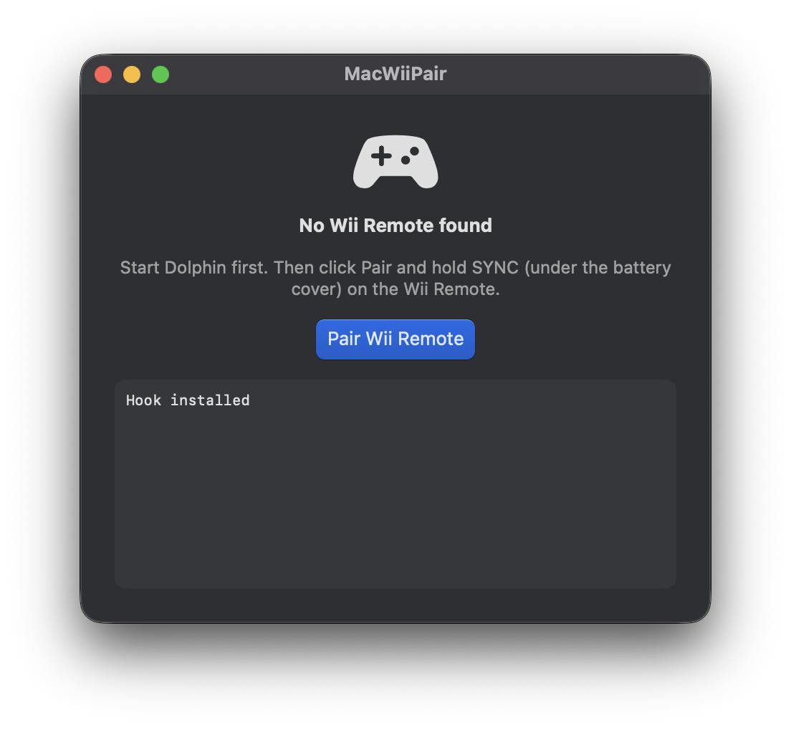

# MacWiiPair

Pair a Wii Remote with your Mac and play with it in Dolphin on macOS 27.


[](https://github.com/aureliothuerch/MacWiiPair/releases/latest)

MacWiiPair is a small native app. It scans for a Wii Remote, starts the
pairing, and leaves the controller ready for Dolphin. It is a Swift package
that builds from the command line and needs no kernel extension.

**[Download the latest release](https://github.com/aureliothuerch/MacWiiPair/releases/latest)**

<p align="center"></p>

## Why

Older pairing tools break on macOS 27. IOBluetooth answers the Wii Remote's PIN
request itself and never calls the app, so pairing times out. Users report
errors such as `(os/kern) default set`. MacWiiPair is a new implementation
written for the current system.

## Install

You need an Apple silicon Mac with macOS 27 (tested on 27.0.1), [Dolphin](https://dolphin-emu.org),
and a Wii Remote (a genuine RVL-CNT-01 is tested).

### Download

1. Get `MacWiiPair-<version>.dmg` from the
   [latest release](https://github.com/aureliothuerch/MacWiiPair/releases/latest).
2. Open the DMG and drag **MacWiiPair** onto the Applications shortcut.
3. Open it. The app is not notarized, so macOS blocks the first launch. Open
   System Settings > Privacy & Security and click **Open Anyway**, or run:

```sh
xattr -dr com.apple.quarantine /Applications/MacWiiPair.app
```

### Build from source

You also need Xcode or the Command Line Tools.

```sh
git clone https://github.com/aureliothuerch/MacWiiPair.git
cd MacWiiPair
./build.sh
open build/MacWiiPair.app
```

## Usage

The order matters:

1. **Start Dolphin** and leave it running.
2. Open MacWiiPair.
3. Click **Pair Wii Remote**.
4. Hold the **SYNC** button under the battery cover until the remote connects.
5. The Wii Remote appears in Dolphin's controller settings and stays paired.

## Troubleshooting

| Symptom | Fix |
|---|---|
| LEDs keep blinking, macOS lists the remote as connected | Normal. The LEDs blink until an application such as Dolphin takes over the connection. Start Dolphin. |
| No Wii Remote found | Hold SYNC while the search runs. Press it again if the search ends first. |
| No Bluetooth prompt, nothing happens | Allow Bluetooth for MacWiiPair in System Settings > Privacy & Security. |

## How it works

- `IOBluetoothDeviceInquiry` finds devices named `Nintendo RVL-*`.
- `IOBluetoothDevicePair` starts the pairing. If the system asks for a PIN, the
  app answers with the reversed Bluetooth address of the host (SYNC) or of the
  remote (1 + 2), as WiiBrew documents.
- `PairingHook` logs what CoreBluetooth's pairing agent receives, so later fixes
  rest on observed behavior.

## Status

Version 0.1. I maintain it and update it when a new macOS version breaks
pairing.

| macOS | Mac | Wii Remote | Result |
|---|---|---|---|
| 27.0.1 | Mac16,5 | RVL-CNT-01 | Connects and stays paired with Dolphin |

Known limitations:

- The status text in the app does not report the final pairing result.
- Third-party remotes and the Balance Board are untested.
- Other macOS versions are untested.

Test reports on other setups help. Open an issue with the log from the app window.

## Development

```sh
swift test                                  # unit tests
./package.sh                                # build the release DMG
tools/make-icns.sh                          # rebuild the app icon
swift tools/dump-classes.swift Pairing      # list Objective-C classes by name
```

`dump-classes.swift` reads system frameworks through the public Objective-C
runtime API.

## Contributing

Pull requests are welcome. All contributions fall under GPL-3.0-or-later.
MacWiiPair is an independent implementation, so please do not submit code copied
from [dolphin-emu/WiimotePair](https://github.com/dolphin-emu/WiimotePair) or
its forks.

## Credits

- [MaxfieldKassel/WiimotePair#1](https://github.com/MaxfieldKassel/WiimotePair/pull/1)
  documented the macOS 27 root cause. MacWiiPair shares no code with it.
- [WiiBrew](https://wiibrew.org/wiki/Wiimote) documents the PIN scheme.
- [Dolphin](https://dolphin-emu.org) is the emulator this app serves.

MacWiiPair is not affiliated with Nintendo or the Dolphin project.

## License

GPL-3.0-or-later. See [LICENSE](LICENSE).
